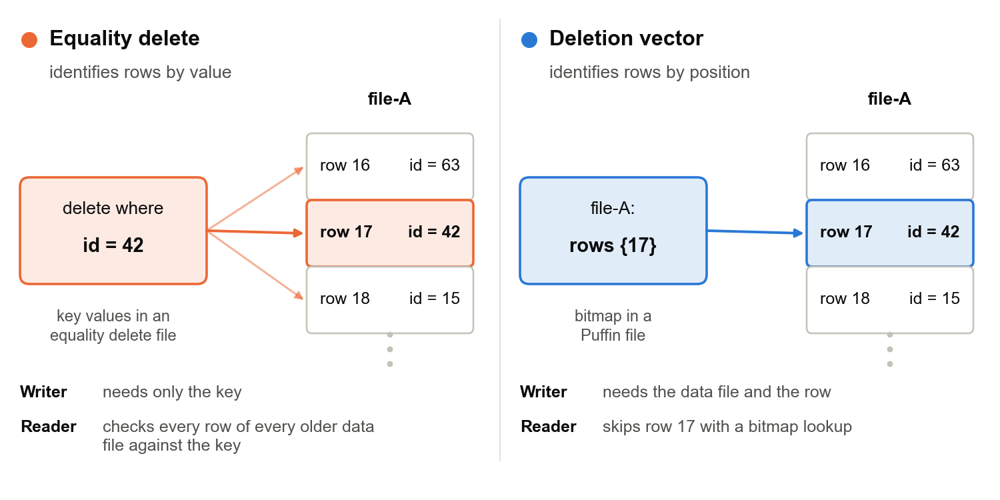
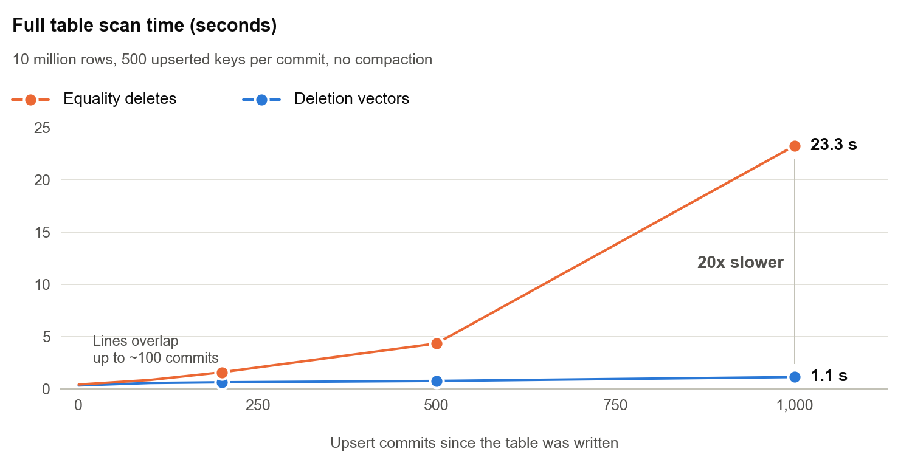
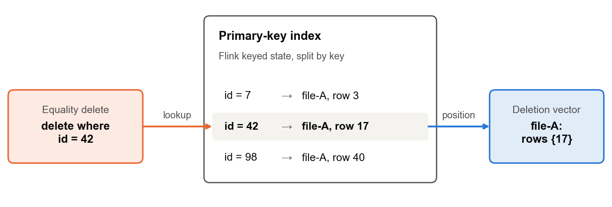
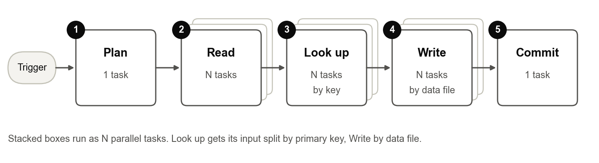

<!--
 - Licensed to the Apache Software Foundation (ASF) under one or more
 - contributor license agreements.  See the NOTICE file distributed with
 - this work for additional information regarding copyright ownership.
 - The ASF licenses this file to You under the Apache License, Version 2.0
 - (the "License"); you may not use this file except in compliance with
 - the License.  You may obtain a copy of the License at
 -
 -   http://www.apache.org/licenses/LICENSE-2.0
 -
 - Unless required by applicable law or agreed to in writing, software
 - distributed under the License is distributed on an "AS IS" BASIS,
 - WITHOUT WARRANTIES OR CONDITIONS OF ANY KIND, either express or implied.
 - See the License for the specific language governing permissions and
 - limitations under the License.
 -->

Equality deletes allow low-latency row-level deletes in streaming applications, but they can greatly impact read performance. In a benchmark, we found that a full scan of a table after 1,000 upsert commits of 500 rows each takes about 23 seconds with equality deletes. The same table with the deletes converted to deletion vectors only takes about 1 second.

When equality deletes were first introduced, they looked like an elegant solution for streaming writes with deletes because they defer the work of resolving deletes to the readers. Yet, their long term costs for readers were underestimated, which caused major pain to many Iceberg users.

To solve this, we built `ConvertEqualityDeletes`, a Flink table maintenance task that converts equality deletes to deletion vectors in the background. The task can be used seamlessly with existing writers, without changing their existing write patterns. In table format v3, this enables converting equality deletes into deletion vectors which allows for efficient reads. For table format v4 and beyond, we believe that this work forms the basis for stopping to write equality deletes altogether.

<!-- more -->

## A short history of deletes

In the v1 table spec, the only way to delete rows was to rewrite the data files that contain them (copy-on-write). The v2 spec added position deletes, which mark rows in existing data files as deleted without rewriting the files. The catch is that readers now have to skip the deleted rows (merge-on-read). The v3 spec replaced position delete files with deletion vectors, which store the deleted row positions of a data file as a compact bitmap.

The v2 spec also added equality deletes for low-latency row-level deletes, typically found in streaming applications like change data capture (CDC). While a position delete marks a row as deleted, an equality delete only records the values of the row's equality columns, for example its primary key.

## Two ways to delete a row

Take a `users` table with the primary key `id`. A Flink job upserts the row with `id = 42`, which deletes the old version of the row and inserts the new one. The old version is row 17 of the data file `file-A`, and the new version goes to a new data file, `file-B`. Iceberg can store the delete in two ways:

- An **equality delete** says "delete every row where `id = 42`". It identifies rows by value, so the writer only needs the key, which it already has.
- A **deletion vector** says "delete row 17 of `file-A`". It identifies rows by position, which the writer needs to keep track of.

<figure markdown="span">{ width="750" }<figcaption>The same delete as an equality delete and as a deletion vector.</figcaption></figure>

Semantically, both describe the same delete. However, equality deletes are cheap to write while producing deletion vectors require the writer to keep track of row positions across data files. On the other hand, equality deletes push the work to resolve the deletes to the readers while deletion vectors are an efficient format for the readers to perform merge-on-read.

## Why equality deletes slow down reads

An equality delete applies to every older data file in its partition. To read `file-A`, a reader loads all newer equality delete files, collects their keys, and checks every row of `file-A` against them. A streaming job commits on every checkpoint, and each commit adds more equality delete files. Older data files collect more and more of them, so reads get slower with every commit until compaction rewrites the data.

To measure this, we modeled a Flink upsert job on a table with 10 million rows. Each commit replaces 500 random keys and adds an equality delete file. We compared full Spark scans of this table with scans of the same table with the deletes stored as deletion vectors, which is what `ConvertEqualityDeletes` produces:

<!--
  TODO: update the numbers, the commit, and the benchmark link with a 3-fork rerun on the upstream
  benchmark. The chart is from the 3-fork sweep. The bucketed and planning numbers are from
  single-fork runs.
-->

<figure markdown="span">{ width="750" }<figcaption>Full table scan time of the same table with equality deletes and with deletion vectors.</figcaption></figure>

Up to 100 commits, the difference is within run-to-run noise. After that, scans with equality deletes slow down quickly. Every commit adds a data file and a delete file that applies to all older data files. The number of data files and the number of delete files per data file both grow with the commits, so the work grows with the square of the number of commits. After 1,000 commits, which are 17 hours of upserts with one-minute checkpoints, only 4.8% of the rows are replaced, yet a scan is 20x slower than with deletion vectors. With deletion vectors, every data file has at most one, and scan time grows slowly, from 0.3 s to 1.1 s.

Partitioning doesn't fix this. With `bucket(5, id)`, a full scan after 1,000 commits still takes 18 s with equality deletes vs. 2.9 s with deletion vectors. Scan planning gets slower as well, by 3x for the unpartitioned table and 12x for the bucketed one.

These numbers are a lower bound. Things could be a lot worse on remote file storage. The benchmark reads from local disk, and Spark caches the parsed delete files between scans. On object storage, every delete file will potentially add additional latency.

*Benchmark: `IcebergSourceUpsertDeleteBenchmark`, Spark 4.2.0 in local mode, Java 17 with a 12 GB heap, on a 10-core laptop. Each number is the mean of 3 runs in separate Java virtual machines with 5 measured scans each. At 1,000 commits, 8 s of the 23 s are garbage collection pauses. Without them, the slowdown is about 13x.*

We've learned that a deletion vector avoids comparing rows with delete keys. The reader skips the deleted rows with a bitmap lookup. So why doesn't the writer produce deletion vectors in the first place? To do that, it has to find the file and row of `id = 42` for every upsert, which means reading data files while ingesting. That's too slow for a streaming job.

There are workarounds, but they all come with costs. Copy-on-write rewrites data files on every update. Frequent compaction rewrites unchanged data. Batch upserts, for example by using a raw table plus a periodic `MERGE`, add considerable latency.

Ideally, we want equality deletes on the write path and deletion vectors on the read path. That's what ConvertEqualityDeletes does.

## Enter ConvertEqualityDeletes

### How ConvertEqualityDeletes works

`ConvertEqualityDeletes` is a Flink table maintenance task, like compaction or snapshot expiration. With Flink's `IcebergSink`, it runs in the same Flink job and starts a conversion cycle after each commit. The writers don't change and keep writing equality deletes. Each cycle converts the equality deletes of one snapshot to deletion vectors and commits them in a new snapshot, so readers see the table either before or after the conversion. Once a commit is converted, readers apply its deletes as deletion vectors.

<figure markdown="span">{ width="750" }<figcaption>ConvertEqualityDeletes runs in the same Flink job as the IcebergSink and replaces equality deletes with deletion vectors.</figcaption></figure>

### With or without a staging branch

The task runs in one of two modes. They differ in where the sink writes and where the task commits:

- **In place:** The sink writes data files and equality deletes to a branch, for example `main`, and the task replaces the equality deletes with deletion vectors on the same branch. New data is visible right away, and readers apply the remaining equality deletes until the conversion commit lands. This is the default of the `IcebergSink`.
- **With a staging branch:** The sink writes to a staging branch, for example `staging`, and the task commits the data files and their deletion vectors to a separate target branch, for example `main`. The equality deletes stay on the staging branch, so readers of `main` never see them, and engines that can't apply equality deletes can read `main`. The trade-off is latency: new data appears on `main` only after its conversion.

Both modes run the same conversion cycle, described below. [Using it](#using-it) shows how to configure each mode.

### From values to positions: the primary-key index

To turn "delete `id = 42`" into "delete row 17 of `file-A`", the task needs to know where each key lives. It keeps a primary-key index that maps every live key to its data file and row:

<figure markdown="span">{ width="750" }<figcaption>An equality delete looks up its key in the primary-key index. The hit is the position for the deletion vector.</figcaption></figure>

The index lives in Flink keyed state and is saved with every checkpoint, so a restarted job continues with its index. It grows with the number of live rows, not with the number of deletes. The data files of each commit add their keys to the index. Other writers change the table too, so the task also keeps the index current, see [Incremental re-indexing](#incremental-re-indexing).

### A conversion cycle, step by step

A conversion cycle is a regular parallel Flink pipeline with five steps:

<figure markdown="span">{ width="750" }<figcaption>The five steps of a conversion cycle.</figcaption></figure>

1. **Plan:** pick the oldest commit that isn't converted yet, and list the data files that bring the index up to date. These are the data files that other commits added to or removed from the target branch since the last cycle, or all data files if the index must be rebuilt (see [Incremental re-indexing](#incremental-re-indexing)). If there is no commit to convert, the cycle only updates the index.
2. **Read:** read the listed data files, the equality delete files of the picked commit, and, with a staging branch, its new data files.
3. **Look up:** the index first applies the rows of the added and removed data files. Then it finds each deleted key, for example `id = 42` → `file-A`, row 17. With a staging branch, the new rows of the commit join the index last.
4. **Write:** write one deletion vector per data file. Iceberg allows only one deletion vector per data file, so new positions are merged with the existing one.
5. **Commit:** add the deletion vectors in one commit. In place, the commit also removes the converted equality deletes. With a staging branch, it also adds the new data files to the target branch.

The index is split across subtasks by key, so a delete always reaches the subtask that holds its row. The deletion vector writers are split by data file, so each data file gets exactly one deletion vector.

### Getting the tricky cases right

In the process of implementing, we found that there are some aspects of the conversion that require extra care:

- **Delete and re-insert in one commit.** The upsert of `id = 42` writes a delete and a new row in the same commit, and the delete must not remove the new row. The task reads files in parallel, so records reach the index in any order. With a staging branch, the task processes each cycle in phases with Flink event-time timers: the delete resolves first, and the new rows of the commit go into the index afterwards. In place, the new rows are already in the index, so the task applies the rule of Iceberg readers: an equality delete only removes rows with a lower data sequence number, and the new row has the same sequence number as the delete.
- **Failures.** A failed cycle commits nothing. It may have changed the index already, so the task rebuilds the index before it tries again. After a restart, the index comes back from the last checkpoint, and the next cycle applies the commits since then. If the checkpoint is older than the last conversion commit, the next cycle rebuilds the index instead.
- **Concurrent commits.** Compaction in the same Flink job takes the same maintenance lock, so it never runs during a cycle. If another writer commits during a cycle, the conversion commit fails, and the next cycle rebuilds the index and tries again.

## Incremental re-indexing

In Iceberg 1.12.0, ConvertEqualityDeletes rebuilds the index after every commit by another writer on the target branch, for example a compaction. When converting in place, every commit of the sink counts as well. This keeps the implementation simple, but an index rebuild will mean reading the key column of every data file of the table.

A compaction typically rewrites only a small part of the table, which makes it possible to update the index without a full rebuild. For example, a Spark job rewrites `file-A` and `file-B` into `file-C`. The live row of `id = 42` is now in `file-C`, but the index still points to `file-B`, which is no longer part of the table. We can simply remove the entries for `file-A` and `file-B`, and index `file-C`.

Incremental re-indexing, available in Iceberg 1.13.0 ([#18717](https://github.com/apache/iceberg/pull/18717)), applies only the changes to the index. At the start of each cycle, the task looks for commits by other writers since it last updated the index. It reads the key columns of the data files that these commits added and removed, adds the keys of the added files to the index, and removes the keys of the removed files:

| What changed on the target branch | What the cycle reads | What happens to the index |
|---|---|---|
| A Spark job compacts `file-A` and `file-B` into `file-C` | The key columns of `file-A`, `file-B`, and `file-C` | The entries of `file-A` and `file-B` are removed and the entries of `file-C` are added. `id = 42` now points to `file-C`. |
| A backfill adds `file-D` | The key column of `file-D` | The entries of `file-D` are added. |
| A commit adds or removes no data files, for example a manifest rewrite | Nothing | The index stays as it is. |
| First cycle, a rollback, snapshot expiration, or a failed cycle | The key column of every data file | The index is cleared and built again (full rebuild). |

The task still rebuilds the index when the table history no longer leads back to the indexed snapshot, for example after a rollback or when snapshot expiration removes it. It also rebuilds when a failed cycle might have left the index incomplete, or when reading the changes would cost more than reading the whole table. For that last check, the task compares the row counts of the commits with the row count of the current table. The [nightly documentation](https://iceberg.apache.org/docs/nightly/flink-maintenance/#convertequalitydeletes) lists all cases.

## Using it

`ConvertEqualityDeletes` is available in Iceberg 1.12.0. Iceberg 1.13.0 will add incremental re-indexing.

In upsert or CDC mode, one line on the `IcebergSink` enables the task. By default, it converts in place, on the branch the sink writes to:

```java
IcebergSink.forRowData(dataStream)
    .table(table)
    .tableLoader(tableLoader)
    .upsert(true)
    .equalityFieldColumns(List.of("id"))
    .convertEqualityDeletes()
    .append();
```

To use a staging branch, write to the staging branch and set the target branch:

```java
IcebergSink.forRowData(dataStream)
    .table(table)
    .tableLoader(tableLoader)
    .upsert(true)
    .equalityFieldColumns(List.of("id"))
    .toBranch("staging")
    .convertEqualityDeletes(Map.of(ConvertEqualityDeletesConfig.TARGET_BRANCH, "main"))
    .append();
```

In Flink SQL, enable the task for an upsert table:

```sql
CREATE TABLE users (
  id BIGINT,
  name STRING,
  PRIMARY KEY (id) NOT ENFORCED
) WITH ('format-version' = '3', 'write.upsert.enabled' = 'true');

SET 'table.exec.iceberg.use-v2-sink' = 'true';
SET 'flink-maintenance.convert-equality-deletes.enabled' = 'true';

INSERT INTO users SELECT id, name FROM user_updates;
```

For other writers, run the task in its own Flink job with the `TableMaintenance` API. The [documentation](https://iceberg.apache.org/docs/latest/flink-maintenance/#convertequalitydeletes) has an example.

## What to look out for

ConvertEqualityDeletes is a new feature, first released in Iceberg 1.12.0. Since that release, we have fixed several bugs, and Iceberg 1.12.1 will include the fixes. Iceberg 1.13.0 will also add incremental re-indexing, which matters most when converting in place.

#### Requirements

- The table must use format version 3, the first version with support for deletion vectors.

#### Recommendations

- Use Flink's RocksDB state backend. The index grows with the number of live rows of the table, and RocksDB keeps it on local disk instead of the Java heap.
- Avoid continuous writers other than the sink on the branch the task commits to. Occasional commits, like a backfill, are fine. With a staging branch, run compaction on the target branch, not on the staging branch.
- When you run the task on its own, its equality columns must match the ones the writer uses. The `IcebergSink` sets them automatically.

#### Limitations (subject to change)

- Row lineage isn't supported yet.
- Each cycle converts one commit, and by default at most one cycle starts per minute (`flink-maintenance.rate-limit-seconds`). If the sink commits more often and every commit contains deletes, increase the checkpoint interval or lower the rate limit.

The [documentation](https://iceberg.apache.org/docs/latest/flink-maintenance/#convertequalitydeletes) has the full list of config options.

## What's next

Since we started this work, the community has decided to [forbid adding new equality deletes](https://github.com/apache/iceberg/pull/17783) to v4 tables. The [vote](https://lists.apache.org/thread/5x8ovvz3ppf4krqs543sqjcy3dqdhthm) on that change notes that "the Flink ConvertEqualityDeletes work demonstrates a viable replacement path". For v4 tables, the next step is to build the index in the `IcebergSink` itself, so the sink writes deletion vectors directly and equality deletes never reach the table. We'd also like to support row lineage and, longer term, share the index across engines. A [secondary index specification](https://github.com/apache/iceberg/pull/16961) is under discussion for v4. It would allow us to store the index in the table, so Flink and other engines could use it instead of keeping their own copy.

The design was discussed on the [dev list](https://lists.apache.org/thread/gldqrycmo24r0vo77wzcj9s9b04rtvy7) and in the [design pull request](https://github.com/apache/iceberg/pull/15996). Try `ConvertEqualityDeletes` on your upsert tables and let us know how it works for you on the dev list or in a GitHub issue.

## Thanks

Thanks to [@pvary](https://github.com/pvary) and [@stevenzwu](https://github.com/stevenzwu) for the original design, and to [@pvary](https://github.com/pvary) for the reviews and inspiration. Thanks to [@huaxingao](https://github.com/huaxingao) for driving the deprecation of equality deletes in v4 and for reviews. Thanks also to [@Guosmilesmile](https://github.com/Guosmilesmile) for the documentation and reviews, and to [@wombatu-kun](https://github.com/wombatu-kun), [@swapna267](https://github.com/swapna267), [@manuzhang](https://github.com/manuzhang), [@ferenc-csaky](https://github.com/ferenc-csaky), and [@openinx](https://github.com/openinx) for reviews. Thanks to [@vishnuprakaz](https://github.com/vishnuprakaz), [@yhyyz](https://github.com/yhyyz), [@developer-rpai](https://github.com/developer-rpai), and [@kinolaev](https://github.com/kinolaev) for fixing bugs.

## References

- [Documentation](https://iceberg.apache.org/docs/latest/flink-maintenance/#convertequalitydeletes)
- [Design discussion](https://lists.apache.org/thread/gldqrycmo24r0vo77wzcj9s9b04rtvy7)
- [Design pull request](https://github.com/apache/iceberg/pull/15996)
- [Incremental re-indexing](https://github.com/apache/iceberg/pull/18717)
- [Original design document](https://docs.google.com/document/d/1Jz4Fjt-6jRmwqbgHX_u0ohuyTB9ytDzfslS7lYraIjk/edit)
- [Iceberg 1.12.0 release notes](https://iceberg.apache.org/releases/#1120-release)
- [Best practices for streaming upserts, Lu Niu, dev list, January 2026](https://lists.apache.org/thread/rt7dmg7l78xpzc9w3lwn090yzqq4fyyw)
- [Cost of equality deletes for readers, Steven Wu, dev list, July 2026](https://lists.apache.org/thread/d6g5vxkghj6tj4g1ptjpc9gsmr0o2ysk)
- [Deprecate equality deletes in v4, discussion](https://lists.apache.org/thread/ks01jpv40qjlvz4yop5tlqv4x5oxbwy6)
- [Deprecate equality deletes in v4, vote](https://lists.apache.org/thread/5x8ovvz3ppf4krqs543sqjcy3dqdhthm) and [result](https://lists.apache.org/thread/y4ggjzfh8s9n80w16j857og3800xd3lv)
- [Spec change in v4 to deprecate equality deletes](https://github.com/apache/iceberg/pull/17783)
- [Secondary index specification, apache/iceberg#16961](https://github.com/apache/iceberg/pull/16961)
